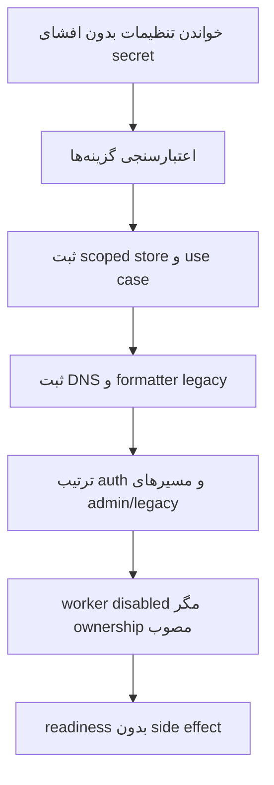
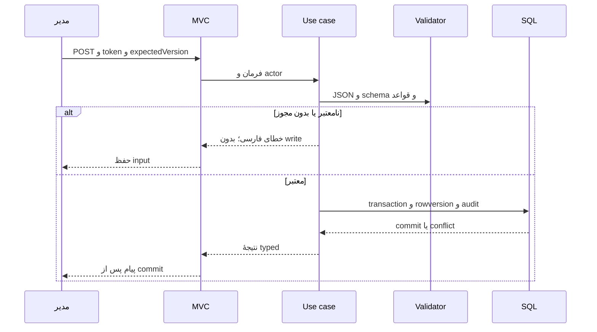
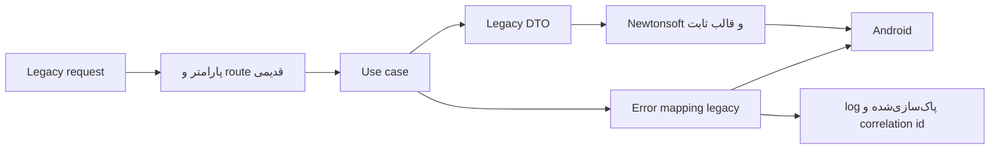
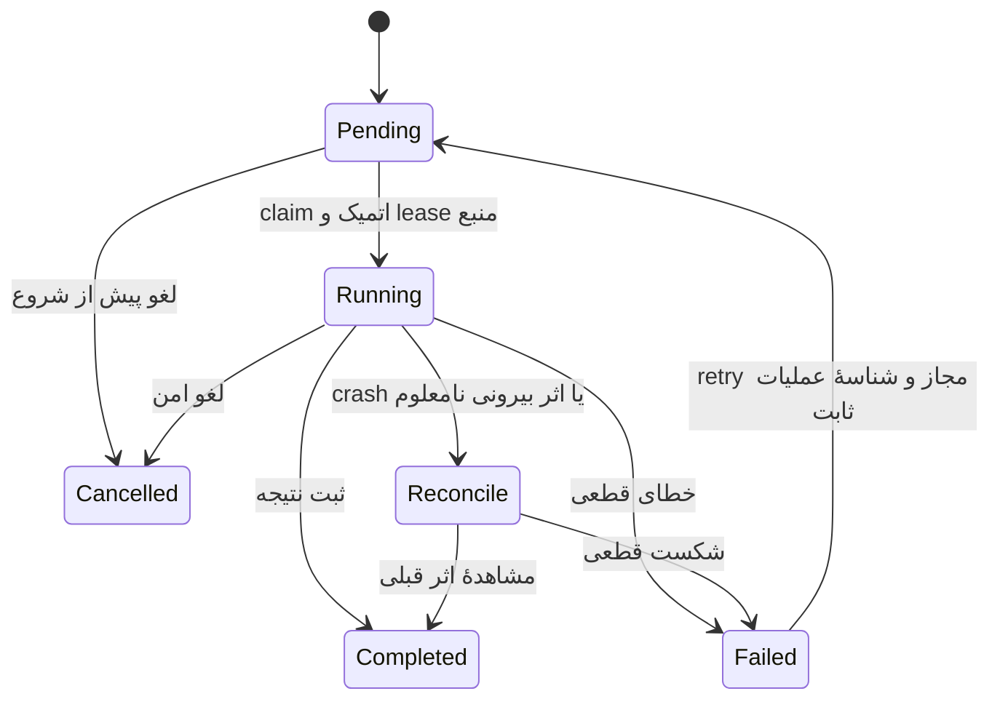

# نمودارهای اجرایی هدف

این نمودارها طراحی پیشنهادی‌اند. startup موجود در [ممیزی معماری](../audit/01-architecture-report.md) شرح داده شده است.

## startup و DI

## درخواست و نوشتن دیتابیس

## پاسخ اندروید و خطا

## اجرای job

Reconcile مرحلهٔ داخلی بازیابی است و می‌تواند در UI به وضعیت خطای نیازمند بررسی نگاشت شود؛ دقیقاً شش status خواسته‌شدهٔ محصول در native-job-engine تفکیک شده‌اند. Disabled وضعیت تعریف job است. نمودار کامل تغییر domain در [مدیریت دامنه](domain-management.md) و validation در [تنظیمات سرور](server-configuration.md) آمده است.
