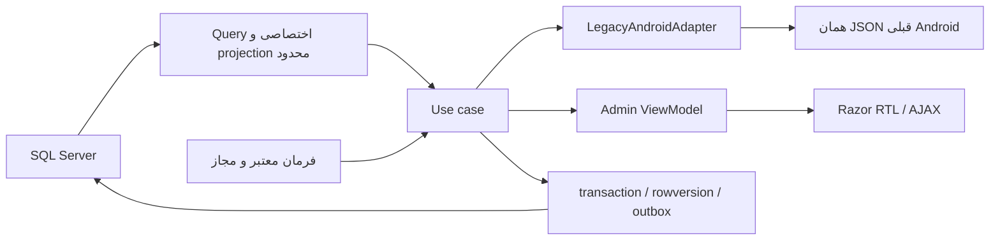

# جریان دادهٔ پیشنهادی

مسیر فعلی SQL -> EF GenericRepository -> سرویس با IQueryable یا entity -> AutoMapper/DTO -> controller -> Json/Razor -> JavaScript است. TestController مستقیماً entity می‌دهد؛ IPConfigService هم entity را به UI می‌فرستد. AppSetting cache نوع entity/DTO مشترک، logهای سراسری، projection ناقص ServerDTO و null group نقاط ناسازگاری‌اند.

query باید filter/order/page را پیش از materialization به SQL بدهد، projection فقط فیلد لازم و آمار aggregate باشد. countهای مکرر در یک query گروه‌بندی شوند؛ N+1 با شمارش SQL command و plan اثبات شود. IQueryable از مرز use case بیرون نرود و cancellation منتقل شود. interface برای query یا provider قابل‌جایگزینی مفید است؛ interface پوسته برای هر DTO لازم نیست.

null، missing، inactive و empty معنای جدا داشته باشند. فهرست admin صفحه‌بندی server-side و sort allowlist بگیرد؛ فهرست Android قدیمی بدون تأیید به envelope جدید تبدیل نشود. cache با نوع و namespace مشخص، TTL مصوب، invalidation با کلید قدیم/جدید و multi-instance؛ دادهٔ وابسته به کاربر در کلید سراسری نباشد.

command اعتبارسنجی و مجوز را پیش از write می‌سنجد؛ actor و operationId ثبت و entity version کنترل می‌شود. خطای UI از error مدل کاربردی فارسی و قابل‌فهم و خطای Android از adapter ثابت عبور کند. Task قبل از Json await شود. موارد invalid در import شمارش و جدا گزارش شوند؛ پاسخ موفق برای عملیات ناتمام مجاز نباشد.
