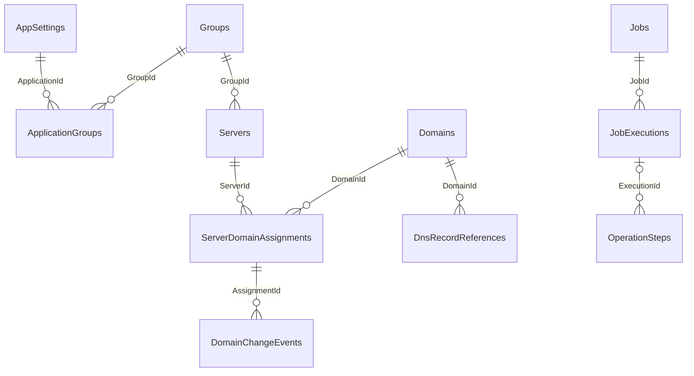

# طرح پیشنهادی دیتابیس

این سند طرح است و migration تولید نمی‌کند. نام‌های جدید پس از تطبیق schema واقعی و دادهٔ موجود نهایی می‌شوند؛ جدول هم‌معنی بدون نیاز ساخته نشود.

جدول‌های Servers، Domains، Groups و AppSettings حفظ می‌شوند. مدل کاربردی می‌تواند InternetDomain نامیده شود و به Domains نگاشت شود. تاریخچهٔ assignment و DNS record reference در schema فعلی معادل قابل‌اعتماد ندارند.

| بخش | constraint و نوع پیشنهادی | شرط تبدیل |
|---|---|---|
| ApplicationGroups | PK(ApplicationId,GroupId)، FK صریح؛ index معکوس GroupId | parse رشتهٔ underscore، نگهداری ترتیب و خام اولیه در staging |
| Domains | نام Unicode اولیه + نام ASCII نرمال‌شده، ZoneId با طول سازگار؛ unique فقط بعد از تعیین scope حساب | بررسی نام تکراری و multi-account؛ عمومی‌کردن نام یکتا حدس زده نشود |
| Servers | GroupId موجود، rowversion، Config فعلی nvarchar(max) حفظ؛ ConfigFormatVersion و ValidationState افزایشی | legacy unknown به‌جای حذف/اصلاح خاموش |
| DnsRecordReferences | zone external id، record external id، مالک کاربردی، name/type/content، LastObservedAtUtc؛ unique(providerAccount,zone,record) | هیچ record صرفاً به دلیل هم‌نامی owned تلقی نشود |
| ServerDomainAssignments | FKهای صریح، ValidFromUtc/ValidToUtc، وضعیت، operation id و rowversion | filtered unique برای assignment جاری در scope مصوب؛ هم‌پوشانی تاریخی بررسی شود |
| DomainChangeEvents | append-only، actor، requestId، before/after hash و وضعیت؛ payload بدون secret | حذف فیزیکی تاریخچه ممنوع؛ retention مصوب |
| Jobs | بازاستفاده با JobName یکتا، Enabled، ScheduleKind، IntervalSeconds/Cron، TimeZoneId، NextDueAtUtc، Version | credential به secret reference؛ دادهٔ قدیمی raw حفظ شود |
| JobExecutions | status، ScheduledForUtc، Attempt، Started/FinishedUtc، duration، ErrorCode، operation id؛ unique(JobId,ScheduleVersion,ScheduledForUtc) | اجرای manual idempotency key مستقل داشته باشد |
| leases | resource key، lease owner، ExpiresAtUtc، monotonic fencing token و rowversion | lease مشترک بین job و درخواست دستی؛ فقط lock job-name کافی نیست |
| User balance | decimal(19,4) پیشنهادی | scale و واحد پول با مالک محصول تعیین و reconciliation شود |

زمان‌های عملیاتی UTC با datetime2 و قرارداد Kind صریح یا datetimeoffset؛ نمایش شمسی در presentation. مقدار decimal به string خارجی تبدیل نشود مگر قرارداد قدیمی همین را بخواهد. JSON برای تنظیم ناهمگن server/job موجه است، رابطهٔ app/group در JSON یا رشتهٔ جداشده موجه نیست.

indexهای candidate: ServerLogs(ServerId,IsActive,Id DESC) با include وضعیت/اپراتور؛ Servers(GroupId,IsAd,IsActive,IsAvailable,Id)؛ Jobs(Enabled,NextDueAtUtc)؛ lease(ResourceKey) unique. انتخاب نهایی با query plan، selectivity، هزینهٔ write و تست حجم انجام شود، نه افزودن کور همهٔ indexها.
