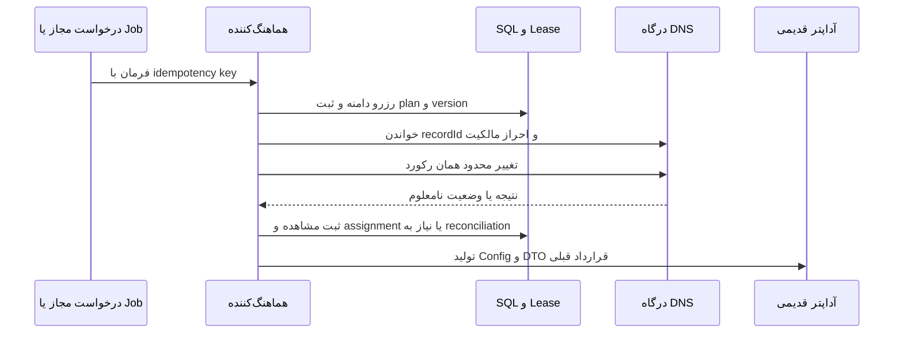

# معماری مدیریت دامنه و DNS

Domain در مدل فعلی «نام دامنهٔ اینترنتی» است؛ با لایهٔ Domain نرم‌افزار اشتباه نشود. Zone شناسهٔ Cloudflare است، DNS record یک منبع مستقل بیرونی و server assignment رابطهٔ زمان‌دار بین سرور و نام مورد استفاده است. CurrentDomainValue هدف CNAME است؛ نام انتخابی جدید و SNI/Host و address الزاماً یک فیلد نیستند.

## مسیر موجود و خطاهای تأییدشده

`ChangeDomain` اولین دامنهٔ active/nondeleted بدون ترتیب قطعی را می‌گیرد، DNS را تغییر می‌دهد، JSON را بازنویسی و سرور را ذخیره می‌کند، سپس دامنه را soft-delete می‌کند. reservation یا transaction بین این مراحل نیست. دو اجرا ممکن است یک domain را بگیرند. سابقهٔ اتصال دامنه و سرور به‌صورت رابطهٔ مستقل وجود ندارد.

`ChangeSubDomain` نام اصلی را با Split و indexهای ۱ و ۲ از SNI/Host استخراج می‌کند؛ برای نام دو‌بخشی، چندسطحی یا public suffix این برداشت معتبر نیست. وجود domain مصرف‌شده/soft-deleted می‌تواند lookup بعدی را بشکند. UpdateServerConfig ZoneId را به خودش نسبت می‌دهد؛ ZoneId جدید لزوماً ثبت نمی‌شود.

`UpdateJsonValues` فقط token موجود را Replace می‌کند؛ مسیر غایب بی‌صدا تغییر نمی‌کند. `DeleteAndCheckDnsAsync`، `record.content` را تاریخ parse می‌کند درحالی‌که wrapper content هدف DNS را برمی‌گرداند و هنگام create تاریخ در Comment نوشته شده است. تابع GetAllRecords نوع record را در DTO حفظ نمی‌کند؛ DeleteDnsRecord همهٔ نتایج برگشتی را حذف می‌کند. pagination خواندن Cloudflare صریح مدیریت نشده، پس این به معنی تضمین فهرست کامل zone هم نیست.

شواهد: `Application/Features/Services/DomainService.cs` متدهای ChangeDomain، ChangeSubDomain، UpdateServerConfig، DeleteDnsRecord و DeleteAndCheckDnsAsync؛ `Application/Features/CloudflareApiClient.cs` متدهای CreateDnsRecordAsync و UpdateDnsRecordAsync. ریسک deletion در [SEC-02](../audit/05-security-report.md) آمده است.

## مرزهای پیشنهادی

- `DomainRotationPolicy` تابع خالص: ورودی snapshot آمار، assignment، health، زمان و candidateهای مرتب؛ خروجی plan یا دلیل عدم تغییر. random seed و tie-break مشخص باشد.
- `ServerDomainAssignmentService`: مالک reservation، version، history، عملیات و حفظ invariants؛ دسترسی SDK ندارد.
- `IDnsProvider`: observe/create/update/delete یک رکورد مشخص با CancellationToken و نتیجهٔ typed؛ Cloudflare implementation در Infrastructure.
- `ServerConfigurationTransformer`: format-aware؛ تغییرهای SNI/Host/address طبق format، بدون حذف فیلد ناشناخته.
- `DomainChangeCoordinator`: SQL state machine و outbox؛ یک operation id در UI/job/API و lease مشترک zone/server.

قبل از write باید zone متعلق به account و نام دامنهٔ موردنظر باشد؛ recordId، نوع، نام، مالک و version مشاهده‌شده تطبیق داده شوند. CNAME unrelated تغییر نکند. update به‌طور پیش‌فرض delete+create نیست. TTL، proxied و comment موجود مگر تغییر مصوب حفظ شوند. رکوردی که wrapper Success=false می‌دهد موفق فرض نشود.

اگر call موفق و SQL ناموفق شد، operation نامعلوم/نیازمند تطبیق ثبت شود؛ retry ابتدا record فعلی را بخواند، نه اینکه رکورد جدید تصادفی بسازد. rollback فقط روی رکورد owned و با مقایسهٔ وضعیت فعلی و before-image انجام شود. اعتبار credential و permission حداقلی در deployment بررسی شود، نه با آزمایش روی DNS زنده.
