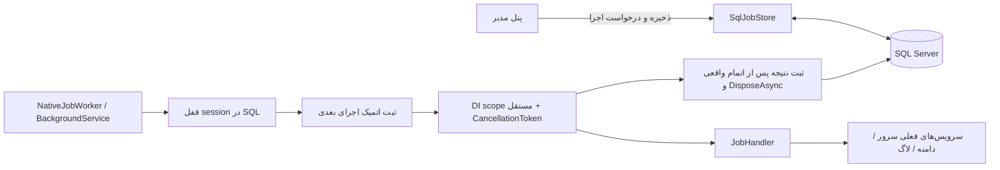

# موتور job بومی .NET

پیاده‌سازی روی شاخهٔ `jobs` از master در `657019e`، با درخواست صریح جایگزینی Hangfire و نگهداری تنظیمات در دیتابیس انجام شده است. این سند وضعیت پیاده‌سازی را توصیف می‌کند؛ معماری پیشنهادی قبلی الزاماً جزئیات همین راه‌حل نیست.

## اجزا و مالکیت

| جزء | مسئولیت |
|---|---|
| `Application/Jobs/JobCatalog` | شش شناسهٔ مجاز، عنوان، پیش‌فرض و نیاز به بررسی پس از شکست؛ بدون اجرای نوع دلخواه از دیتابیس |
| `JobSettings` و `MinuteSchedule` | خواندن تنظیمات قدیمی، اعتبارسنجی و محاسبهٔ خالص موعد دقیقه‌ای UTC |
| `IJobStore` / `Persistence/Jobs/SqlJobStore` | نسخه‌های تنظیمات، موعد و صف دستی ادغام‌شونده، claim، نتیجه و بررسی انسانی |
| `SqlJobExecutionLock` | قفل اختصاصی مشترک بین تمام jobها و نمونه‌های برنامه در همین دیتابیس؛ پایش اتصال و غیرفعال‌سازی |
| `NativeJobWorker` | میزبان .NET، دریافت claim، scope مستقل، timeout/stop و انتظار برای پایان واقعی عملیات و آزادسازی منابع |
| `JobHandler` | انتخاب عملیات شناخته‌شده و قواعد دامنه/IP؛ business داخل کنترلر اجرا نمی‌شود |
| `JobController` | مدیریت تنظیمات، ثبت درخواست و نمایش تاریخچه؛ فقط مدیر، mutation فقط POST همراه antiforgery |

Hangfire، MemoryStorage، dashboard و registrationهای آن حذف شده‌اند. `CronJobService` و service/repositoryهای قدیمیِ تنظیمات که دیگر مصرف نداشتند حذف شده‌اند. DTO قدیمیِ `HangfireDTO` و دیگر schemaهای legacy برای ثابت‌ماندن قرارداد metadata باقی‌اند و هیچ engineای پشت آن‌ها نیست. Dapper نیز پس از حذف آخرین مصرفش در کنترلر CronJobInfo حذف شد؛ اتصال hardcoded آن کنترلر دیگر در کد اجرایی وجود ندارد.

## دیتابیس مرجع است

- `Jobs` همان جدول موجود است. جدیدترین Id هر JobName مرجع است، حتی اگر IsActive=false باشد؛ ردیف‌های قبلی حذف یا بازنویسی نمی‌شوند. ذخیرهٔ پنل یک نسخهٔ تازه اضافه می‌کند. غیرفعال‌سازی با فیلدهای ارسال‌نشده نیز تنظیمات قبلی را حفظ می‌کند؛ ویرایش در حالت غیرفعال قابل‌ذخیره است.
- `JobSchedules` برای هر نوع job یک ردیف دارد: نسخه و fingerprint تنظیمات، فعال‌بودن معتبر، موعد بعدی UTC، درخواست دستی و زمان درخواست، آخرین وضعیت و شمارندهٔ موفقیت. در هر مشاهده/claim، تغییر دیتابیس دوباره خوانده می‌شود؛ ویرایش درجا نیز از طریق fingerprint تشخیص داده می‌شود.
- `JobExecutions` سابقهٔ پایدار شامل شناسهٔ اجرا، نسخهٔ تنظیمات، snapshot فقط فیلدهای عملیاتی، worker، trigger، زمان‌ها، وضعیت، کد خطای محدود و تأیید بررسی است. credential یا متن خام خطای provider وارد history نمی‌شود.
- قفل transaction کوتاه `RazdanehCMS:jobs:configuration:v1` ذخیره و claim را میان instanceها مرتب می‌کند. زمان claim و نتیجه از `SYSUTCDATETIME()` می‌آید؛ ساعت میزبان مرجع برنامه نیست.
- در اولین همگام‌سازی، برای نوعی که هیچ سابقه‌ای ندارد تنظیمات پیش‌فرض ذخیره می‌شود. مانند startup قبلی، فقط logDeleterJob و CheckZoneId به‌طور پیش‌فرض فعال‌اند؛ چهار job تغییردهندهٔ سرور غیرفعال‌اند. تنظیمات موجود با این پیش‌فرض‌ها جایگزین نمی‌شوند.
- رکورد فعالِ قبلی که دوره یا آستانهٔ ضروری ندارد، به‌جای گرفتن مقدار پیش‌فرض و شروع rotation تازه، نامعتبر و متوقف می‌شود. پیش‌فرض فقط برای رکورد تازه یا نمایش/غیرفعال‌سازی تنظیمات خراب است؛ فعال‌سازی نیاز به مقادیر روشن دارد.

مهاجرت `20261019211502_AddNativeJobScheduling` فقط دو جدول و indexهای جدید می‌سازد. Jobs، CronJobInfos، دادهٔ قدیمی و schema سرور/Android حذف یا تبدیل نمی‌شوند. فیلد Timer جدول CronJobInfos قبلاً مرجع scheduler نبود؛ مقدار قدیمی آن به فاصلهٔ جدید تعبیر نمی‌شود. endpointهای سازگاری CronJobInfo اکنون زمان‌بندی و شمارندهٔ واقعی پاک‌سازی لاگ را نمایش می‌دهند.

## زمان‌بندی و عدم تداخل

معنای فعلی `*/N * * * *` حفظ شده: N بین ۱ و ۵۹، timezone برابر UTC. عدد ۴۵ یعنی دقیقهٔ ۰ و ۴۵ هر ساعت، نه فاصلهٔ ثابت ۴۵ دقیقه. زمان بعدی از ساعت برنامه محاسبه می‌شود؛ طول عملیات آن را به interval جدید تبدیل نمی‌کند. پس از خاموشی فقط یک اجرای عقب‌افتاده برای هر job انجام می‌شود و موعد به آینده می‌رود؛ صف چرخش چندروزه بازپخش نمی‌شود.

اجرای دستی در JobSchedules ذخیره می‌شود. چند درخواست یک job به یک درخواست ادغام می‌شوند؛ درخواست قدیمی‌تر جلوتر قرار می‌گیرد. ذخیرهٔ تنظیمات معتبرِ فعال درخواست منتظر را حفظ می‌کند؛ غیرفعال‌سازی یا تنظیمات نامعتبر آن را پاک می‌کند. اجرای دستی و خودکار از همان قفل و همان handler می‌گذرند.

قفل `RazdanehCMS:jobs:execution:v1` از نوع SQL application lock، Exclusive و Session است. یک اتصال اختصاصی با Pooling=false و ConnectRetryCount=0 مالک آن است؛ قفل تا پایان واقعی handler، DisposeAsync scope و ثبت نتیجه نگه داشته می‌شود. jobهای مختلف نیز هم‌زمان اجرا نمی‌شوند تا rotation، پاک‌سازی DNS و حذف آمار روی هم اثر نگذارند. این روش عمداً اجرای موازی را قربانی جلوگیری از تداخل می‌کند.

قفل TTL ندارد تا صرفاً با دیرشدن heartbeat، writer دیگری روی اثر بیرونی بدون fencing شروع نشود. هر دو ثانیه مالکیت session و تنظیمات کنترل می‌شوند؛ خرابی query پایش حداکثر مهلت پنج ثانیه دارد. غیرفعال‌سازی درخواست لغو می‌دهد؛ ویرایش فعال، snapshot اجرای جاری را عوض نمی‌کند و برای اجرای بعدی است. CancellationToken به عملیات Cloudflare و مسیرهای اجرایی دامنه/IP منتقل شده و پیش از نوشتن داخلی دوباره کنترل می‌شود.

`WaitAsync` برای رهاکردن handler در timeout استفاده نشده است. اگر handler cancellation را نادیده بگیرد، قفل تا پایان واقعی آن نگه داشته می‌شود. kill نهایی فرآیند همچنان می‌تواند اثر بیرونی نامطمئن باقی بگذارد.

## crash، قطع اتصال و شکست

claim و جابه‌جایی موعد در transaction واحد ثبت می‌شوند. worker بعدی فقط پس از گرفتن قفل اجرا می‌تواند Running بدون مالک را Interrupted کند. قطع session ثابت نمی‌کند فرآیند قبلی متوقف شده است؛ پس اجرای رهاشده یا قطع اتصال برای هر شش نوع NeedsReview ایجاد و dispatch جدید را متوقف می‌کند، حتی اگر عملیاتش تکرارپذیر باشد. برای چهار job تغییردهندهٔ سرور، شکست یا لغوِ خاتمه‌یافته نیز نیازمند بررسی است؛ retry خودکار DNS وجود ندارد. پاک‌سازی لاگ و تکمیل zone فقط پس از شکست/لغوی که task آن واقعاً پایان یافته و session آن از دست نرفته، می‌توانند در نوبت بعدی ادامه یابند.

مدیر باید نمونهٔ قبلی را متوقف و اثر SQL/DNS را بررسی کند، سپس از پنل اجرای نامطمئن را تأیید کند. هویت و زمان بررسی ثبت می‌شود. تأیید، همان اجرا را replay نمی‌کند؛ اجرای بعدی موعد مستقل یا درخواست دستی تازه دارد. Cloudflare fencing token این برنامه را نمی‌شناسد؛ exactly-once یا transaction مشترک SQL و DNS تضمین نشده است.

timeout پیش‌فرض ۱۵ دقیقه، poll پنج ثانیه و `NativeJobs:Enabled=true` است. در shutdown دریافت کار قطع و لغو منتقل می‌شود؛ worker منتظر task واقعی و آزادسازی scope می‌ماند. در خطای store، با فاصلهٔ حداقل ۳۰ ثانیه دوباره تلاش می‌شود و خطای تکراری پشت سر هم log نمی‌شود.

پیش از هر عملیات store، زیر قفل configuration و همان transaction، `SqlJobSchema.EnsureCreatedAsync` جدول‌های جاب را بررسی و جدول گمشده و indexهایش را می‌سازد. تعریف DDL از خود migration افزایشی AddNativeJobScheduling تولید می‌شود؛ migrationهای تاریخی اجرا نمی‌شوند و جدول موجود تغییر نمی‌کند. وجود Jobs پیش‌نیاز است. اگر EF history موجود باشد فقط ردیف همین migration ثبت می‌شود؛ history قدیمیِ نامعلوم ساخته یا baseline نمی‌شود. ساخت، ثبت history و عملیات store با هم commit یا rollback می‌شوند؛ چند instance نیز همان قفل را دارند. worker فعال در اولین claim و پنل در اولین دسترسی این مسیر را اجرا می‌کنند.

اگر migration قبلاً ثبت شده یا جدول باقی‌مانده دارای داده باشد، بازسازی با یک history از نوع Recovery و کد `schema_recreated` ثبت می‌شود؛ dispatch تا review متوقف است چون دادهٔ حذف‌شده قابل‌بازیابی نیست. حذف هم‌زمان دو جدول و history قابل‌تشخیص قطعی از نصب اولیه نیست. این راه‌اندازی، repair همهٔ ستون‌ها یا migrationهای قدیمی نیست. در نبود مجوز ساخت/دسترسی، `JobSchemaNotReadyException`، صفحهٔ راه‌اندازی پنل و JSON مدیریت job با 503 و پیام مشخص باقی می‌مانند؛ پس از اصلاح دسترسی، تلاش بعدی بازیابی می‌شود. روی schema آماده، مجوز DDL استفاده نمی‌شود.

## قواعد عملیاتی حفظ‌شده

| job | عملیات |
|---|---|
| DomainJob | سرور active/available، آمار موجود با Count مثبت، سن دامنه بزرگ‌تر از expiry و تعداد/درصد گرد‌شدهٔ شکست حداقل آستانه؛ سپس همان ChangeDomain |
| SubDomainJob | همان تغییر زیردامنه برای شناسه‌های active/available، به‌ترتیب و با کنترل لغو |
| DeleteDnsJob | همان سرویس فعلی DeleteDnsAsync با expiry؛ الگوریتم مالکیت/حذف DNS در این گام بازنویسی نشده |
| IpConfigJob | آمار موجود و سن بزرگ‌تر از expiry؛ همان GenerateUpdateAsync با خواندن async در مسیر اجرا |
| logDeleterJob | حذف logهای موجود تا watermark آغاز در batchهای ۲۰۰۰تایی؛ logهای تازه‌تر باقی می‌مانند؛ سیاست retention تازه‌ای تحمیل نشده |
| CheckZoneId | همان InitZoneId برای دامنه‌های فعالِ بدون zone |

تنظیمات credential قبلاً در برخی فرم‌ها ذخیره می‌شدند ولی عملیات job از CloudflareData سراسری استفاده می‌کرد. فرم جدید credential دریافت نمی‌کند و نسخه‌های تازه فقط تنظیمات عملیاتی دارند؛ مقادیر قدیمی در تاریخچهٔ Jobs دست‌کاری نشده‌اند.

## محدودهٔ سازگاری

پاسخ‌ها، DTOها و serializer اندروید ثابت‌اند؛ ۲۸ snapshot قبلی بازتولید نشده‌اند. تغییر مصوب این گام در مدیریت job است: admin-only، POST و CSRF برای mutation، اجرای enqueue به‌جای business در request و سه اکشن جدید Save/Run/Review. آزمون metadata فقط همین تغییرهای مشخص را مستثنا می‌کند و بقیهٔ اکشن‌های قدیمی را کامل مقایسه می‌کند. schema هر ۴۴ DTO بدون تغییر کنترل می‌شود.

قفل مشترک، اجرای jobهای این engine را محافظت می‌کند. endpointهای قدیمی تغییر مستقیم DNS/Config خارج از مسیر job و برنامه‌های خارجی به این قفل متعهد نشده‌اند؛ جلوگیری از تعارض آن‌ها و بازنویسی مالکیت DNS خارج این گام است. منطق حذف گستردهٔ DNS و انتخاب IP قدیمی همچنان باید در گام اختصاصی خود اصلاح شوند. این PR نباید ادعای رفع همهٔ مشکلات DNS یا تضمین اجرای دقیقاً یک‌بار داشته باشد.

روش cutover، اسکریپت SQL و تست‌های اجراشده در [راهنمای استقرار و آزمون](../testing/native-jobs.md) است.
