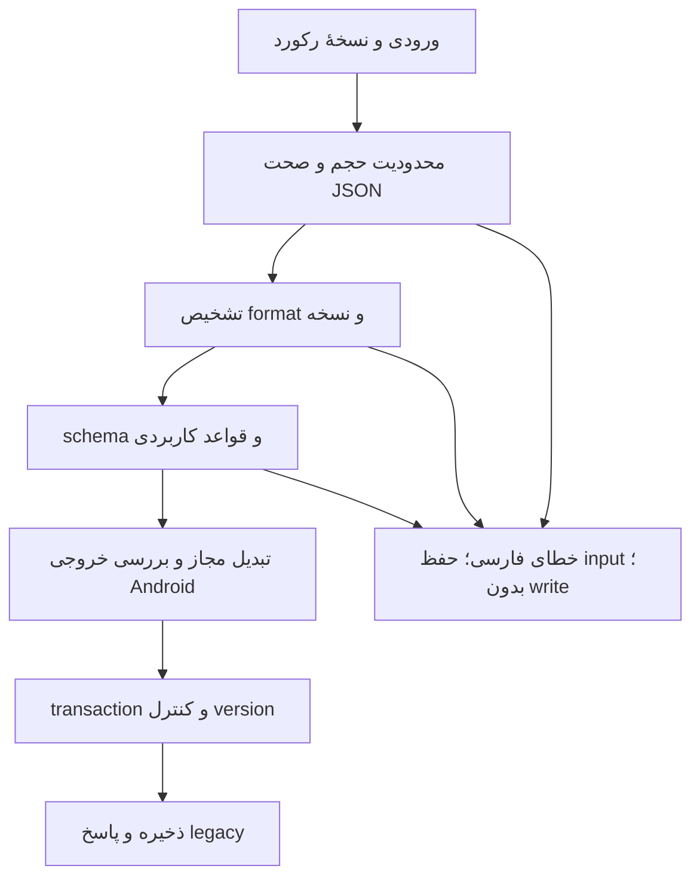

# تنظیمات JSON سرور

## محل ذخیره و مسیرهای write

فیلدهای واقعی: `Server.Config` متن JSON، `ConfigKey` نام placeholder، `ConfigValue` پسوند جایگزین، `CurrentDomainValue` هدف DNS. Job.JobConfig قالب جدا و حاوی config زمان‌بندی/credential است؛ schema آن با Config سرور یکی نیست.

write دستی: کنترلر عمومی Servers.Create/Edit و Area Admin Servers.Create/CreateAd/Edit/EditAd -> ServerService.Create/Edit -> repository. فقط Required برای Config وجود دارد؛ JSON parse پیش از save انجام نمی‌شود. Duplicate نسخهٔ موجود را تکثیر می‌کند. write خودکار: DomainService.UpdateServerConfig/UpdateTcpServerConfig، ServerService.EditServer/UpdateServer و IpConfigService.UpdateIpServers -> Edit. هیچ policy اعتبارسنجی مرکزی این مسیرها را یکسان پوشش نمی‌دهد.

خواندن Android: GetByApp پس از انتخاب، `Replace("@" + ConfigKey, DateTime.Now.Ticks + "." + ConfigValue)` انجام می‌دهد؛ payload خارجی همچنان string است. این replace می‌تواند placeholder خالی یا محل نامناسب را دستکاری کند. UI در adminJs/server.js ابتدا JSON.parse بدون catch انجام می‌دهد؛ تابع tryParseErrors در همان فایل فقط پاسخ خطا را می‌خواند و اعتبارسنجی Config ورودی نیست. تنها بررسی HTML required، اعتبار JSON را تضمین نمی‌کند.

مسیرهای مشاهده‌شده: `outbounds[0].settings.vnext[0].address`، `outbounds[0].streamSettings.tlsSettings.serverName` و `outbounds[0].streamSettings.wsSettings.headers.Host`. این‌ها وجود formatی شبیه VMess/V2Ray با transport خاص را نشان می‌دهند؛ همهٔ protocolها یا schema رسمی و نسخهٔ آن از این کد قابل‌استنتاج نیست. هیچ fixture واقعی کاربر به‌عنوان schema قطعی نپذیرفته‌ایم.

## طراحی اعتبارسنجی پیشنهادی

۱. محدودیت bytes/depth، بررسی encoding و JsonDocument parse با خط و BytePositionInLine؛ محدودیت‌ها باید برای legacy سنجیده شوند. duplicate property، comment و trailing comma در parserهای فعلی ممکن است semantics متفاوت داشته باشند؛ سیاست تازه بدون نمونهٔ واقعی سفت نشود.

۲. تشخیص format با signature و metadata نسخه‌دار؛ unknown یا ambiguous با پیام روشن و نگهداری متن editor رد/قرنطینه شود، نه اصلاح حدسی. برای دادهٔ قدیمی در DB ابتدا گزارش shadow، بدون حذف یا rewrite.

۳. root و مسیرهای لازم برای همان protocol/transport، نوع object/array/string/int، طول‌ها، port بین ۱ و ۶۵۵۳۵ در صورت وجود، IP با parser و hostname/IDN طبق سیاست مشخص اعتبارسنجی شوند. برای transport بدون TLS، serverName اجباری عمومی نباشد؛ HTTP Host ممکن است نیازهای خاص داشته باشد و نباید با قانون یکسان IP/DNS بی‌دلیل رد شود.

۴. فیلدهای ناشناختهٔ پشتیبانی‌شده و optional حفظ شوند. مقدار خام و hash حفظ؛ normalize فقط در صورت اثبات بی‌اثر بودن روی client. جایگزینی placeholder روی clone کنترل‌شده و سپس اعتبارسنجی payload نهایی انجام شود، نه string replace کور.

۵. validator مرکزی در use case پیش از تمام writeها، شامل duplicate/import/job/domain/IP؛ نتیجهٔ failure transaction را متوقف کند و version/config سالم قبلی باقی بماند. لغو و هم‌زمانی با rowversion کنترل شود.

۶. frontend parse سریع و پیام کنار مسیر؛ backend authoritative و همان input بازگردانده شود؛ modal بسته و پیام موفق نشان داده نشود. هیچ محتوای Config در telemetry چاپ نشود. مسیر API قدیمی error shape مصوب خود را حفظ کند.

نمونهٔ پیام: «ساختار JSON معتبر نیست. خط ۳، ستون ۱۲ را بررسی کنید.»؛ «فیلد outbounds[0].settings.vnext[0].address معتبر نیست.»؛ «مقدار port باید عدد صحیحی بین ۱ و ۶۵۵۳۵ باشد.» شماره ستون BytePosition است؛ برای متن فارسی با ستون کاراکتری اشتباه نشود.

پیاده‌سازی این validator به شاخهٔ Iteration 2 موکول است؛ در ممیزی فقط نقص و طرح ثبت شده‌اند.
