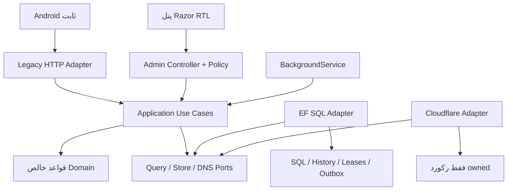

# معماری هدف پیشنهادی

وضعیت: پیشنهاد برای بازبینی؛ پیاده‌سازی و baseline هنوز تأیید نشده‌اند. این معماری باید با [قراردادهای قدیمی](../audit/02-android-api-contracts.md) و [طرح مهاجرت داده](data-migration-plan.md) خوانده شود.

مدل یکپارچهٔ ماژولار برای اندازهٔ فعلی کافی است؛ microservice یا بازنویسی کامل پیشنهاد نمی‌شود. مسئولیت‌ها بدون تغییر فوری نام پروژه‌ها جدا شوند:

- Domain: قواعد خالص انتخاب/rotation، value objectهای نام دامنه و port و transitionهای مجاز؛ EF/SDK/MVC خارج این مرز.
- Application: use caseهای مدیریت سرور، تنظیمات، assignment و job؛ DTO داخلی، validation و policy/authorization با وابستگی لازم و قابل‌آزمون.
- Persistence: mapping صریح EF، transaction، projection query، rowversion، outbox و lease SQL.
- Infrastructure: Cloudflare adapter، فایل خارج webroot، time/random و secret provider؛ خطاهای typed و cancellation.
- Web اصلی: legacy adapter مستقل برای Android و control plane مدیریتی با مجوز و antiforgery؛ هیچ business/DNS در controller.
- Worker: BackgroundService با scope هر اجرا؛ ابتدا در همان deployment یا worker process مستقل بر حسب عملیات، بدون نیاز به microservice.

گراف dependency conceptual است: implementation به contract وابسته است و composition root binding را انجام می‌دهد؛ جهت فلش SQLAdapter به Ports، reference است نه جریان request. legacy adapter owner قرارداد خارجی است؛ entityهای persistence یا DTO جدید admin مستقیم جایگزین آن نمی‌شوند.

نام‌های پیشنهادی: InternetDomain، ServerDomainAssignment، DnsRecordReference، DomainRotationPolicy، ServerConfigurationValidator و JobExecutionCoordinator. اگر entity/table موجود مفهوم را دارد rename منطقی و mapping کافی است؛ جدول موازی بی‌دلیل نسازید.

هر تغییر داخلی و guard سازگاری: جداکردن entity با snapshot serializer؛ normalized app/group با dual-read؛ domain assignment با همان Config؛ موتور job با یک writer و shared resource lease؛ validator با profile واقعی و حفظ optional؛ امنیت با شناسایی مصرف legacy؛ pagination فقط admin جدید. gateها در [ریسک‌ها](../audit/03-compatibility-risks.md) دقیق‌تر آمده‌اند.

معیار موفقیت عملی: بدون اختلاف ناموجه contract، بدون orphan یا گم‌شدن داده، بدون write نامعتبر، بدون deletion نامرتبط، بدون هم‌پوشانی دو موتور، history ماندگار و rollback آزمایش‌شده. هیچ‌کدام با طراحی صرف احراز نمی‌شوند.
