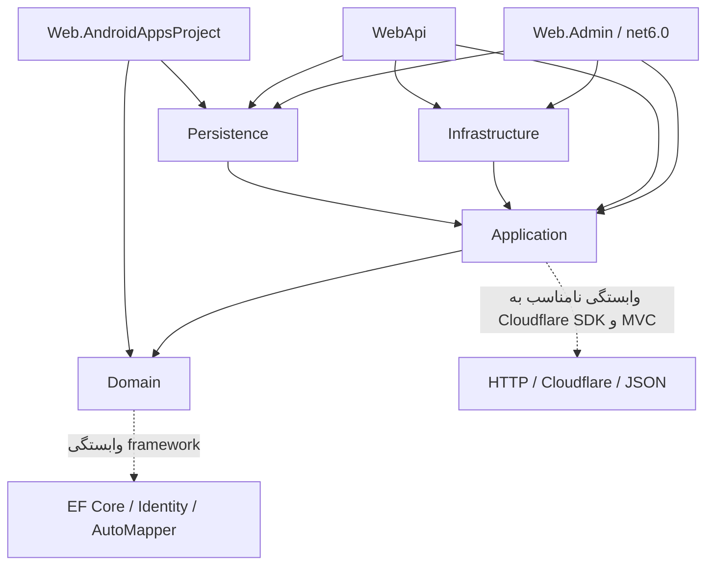

# معماری موجود

مبنای بررسی و محدودیت‌ها در [راهنمای ممیزی](README.md) آمده است. محصول اصلی، پنل MVC و API قدیمی در یک میزبان است؛ سرویس جداگانهٔ WebApi پیاده‌سازی دیگری با رفتار متفاوت دارد.

## مسئولیت واقعی پروژه‌ها

| پروژه | مسئولیت و وضعیت واقعی | مسئله |
|---|---|---|
| `Project.Domain` | entityهای EF، IdentityUser و enum اپراتور/اتصال؛ net10.0 | به EF، Identity و AutoMapper وابسته است؛ لایهٔ مدل مستقل از framework نیست |
| `Project.Application` | DTO، repository interface، سرویس، انتخاب سرور، تبدیل JSON، دسترسی Cloudflare، middleware و MVC filter | حدود ۵۴۶ خط DomainService و ۴۴۳ خط ServerService؛ زیرساخت شبکه و HTTP وارد منطق کاربرد شده |
| `Project.Persistence` | DbContext، migration و repositoryهای عمدتاً پوسته روی GenericRepository | IQueryable و semantics حذف به مصرف‌کننده نشت می‌کند؛ هر write فوراً save می‌شود |
| `Project.Infrastructure` | ایمیل، SMS و ذخیرهٔ فایل | ثبت ایمیل/SMS در registration کامنت است؛ میزبان اصلی این registration را فراخوانی نمی‌کند |
| `Project.Web.AndroidAppsProject` | API اندروید، پنل Admin، Identity، Hangfire و Dapper | نام پروژه دامنهٔ واقعی مسئولیتش را بیان نمی‌کند؛ عملیات خطرناک و زمان‌بندی داخل controller |
| `Project.Web.Api/WebApi` | Minimal API، Swagger و نمونهٔ forecast | قرارداد جدا؛ AppSetting فقط ورودی را echo می‌کند؛ AddIp تغییرات را SaveChanges نمی‌کند |
| `Project.Web.Admin` | پنل قدیمی محتوای سایت، نقش و permission؛ خارج solution | net6.0 به کتابخانه‌های net10.0 reference دارد؛ سرویس‌هایی مانند IFaqService و IPageService در کد حاضر تعریف نشده‌اند. آمادهٔ جایگزینی پنل اصلی نیست |

## گراف reference واقعی فایل پروژه

چرخهٔ reference پروژه یافت نشد. referenceهای transitive باعث می‌شوند میزبان اصلی از Application استفاده کند بدون reference مستقیم. این وضعیت با چرخهٔ DI متفاوت است؛ زنجیرهٔ `IpConfigService -> DomainService -> ServerService -> AppSettingService -> GroupService` چرخهٔ آشکاری ندارد.

## startup و DI

شاهد: `CMS/Project.Web.AndroidAppsProject/Program.cs` و registrationهای سه لایه.

۱. ثبت repository و DbContext به‌صورت scoped، memory cache و mapper singleton.
۲. `CloudflareApiClient` singleton با گزینه‌های ثابت؛ credential خالی هنگام resolve استثنا می‌دهد. این موضوع مانع بعضی کنترلرها می‌شود حتی اگر اکشن انتخابی DNS لازم نداشته باشد.
۳. `CronJobService` singleton از provider ریشه سرویس scoped می‌گیرد؛ با scope validation می‌تواند شکست بخورد و بدون آن عمر DbContext نامناسب می‌شود.
۴. Hangfire از MemoryStorage استفاده می‌کند؛ dashboard و worker پیش از middleware احراز هویت نصب شده‌اند. محافظ پیش‌فرض محلی dashboard با مجوز admin برابر نیست.
۵. ترکیب UseMvc و endpoint routing، دو UseAuthentication و تنظیم EnableEndpointRouting=false مسیر تحلیل و نگهداری را پیچیده کرده است.
۶. startup به شکل synchronous حساب اولیه می‌سازد؛ خطاهای آن بدون log بلعیده می‌شوند. اجرای برنامه معادل «فقط خواندن» نیست.

## جریان کسب‌وکار تأییدشده

`Api/GetGeneralApp` تنظیمات برنامه و دو سرور عادی/تبلیغی را می‌گیرد. گروه‌ها از رشتهٔ underscore جدا می‌شوند. تشخیص ISP بعد از operator ورودی می‌تواند نتیجه را override کند. سرور باید active، available و مطابق IsAd باشد. پاسخ Config به‌صورت رشته است و token مربوط به ConfigKey در زمان خواندن با ticks و ConfigValue جایگزین می‌شود.

انتخاب سرور به log مشترک وابسته است، نه session کاربر یا app. `GetLastLog` پس از descending از LastOrDefault استفاده می‌کند و در واقع قدیمی‌ترین log فعال را می‌گیرد؛ SelectServer index فهرست را با Id مقایسه می‌کند. فهرست خالی می‌تواند خطا بدهد. اصلاح این عیب رفتار قابل‌مشاهده را تغییر می‌دهد و باید سناریوی سازگاری داشته باشد.

## کد تکراری، ناقص و دادهٔ ارائه‌شده

- کلاس‌های `Application/Jobs/*Job.cs` خالی‌اند؛ JobManager تقریباً کامل کامنت است؛ engine فعال همان JobController و CronJobService است.
- نام logDeleterJob هم در startup و هم constructor کنترلر LogDeleter ثبت می‌شود؛ دسترسی HTTP می‌تواند تعریف آن را عوض کند.
- `GetAllIds` و `GetActiveIds` یک منطق دارند؛ PaginateDTO در دو namespace و DTOهای آمار مشابه وجود دارد.
- DapperQueryService ثبت شده ولی فراخوانی GetServerByApp در کد حاضر پیدا نشد. خطر SQL آن با reachability عمومی اشتباه نشود.
- repositoryهای تخصصی معمولاً فقط سازنده دارند؛ API عمومی IQueryable امکان queryهای متفاوت و بدون قرارداد مشخص را به لایهٔ بالا می‌دهد.
- تست خودکار پروژه‌ای و CI workflow اجرایی پیدا نشد. پوشهٔ `.github/upgrades` گزارش برنامهٔ upgrade است، نه اثبات اجرای CI.
- فایل‌های vendor، باینری و backup به‌عنوان محتوای مخزن فهرست شدند؛ reverse engineering باینری‌ها انجام نشده است.

## وضعیت build

در این جلسه `dotnet build RazdanehCMS.sln --no-restore -m:2` با SDK 10.0.402 موفق شد: ۸ warning و صفر error در اجرای incremental. این نتیجه برای ۶ پروژهٔ solution است؛ Web.Admin در آن نیست. هم‌زمانی AutoMapper 16.2 و extension قدیمی 12 نیازمند بررسی runtime است؛ صرف نام نسخه اثبات خرابی نیست. warningهای pruning و advisory در [گزارش امنیت](05-security-report.md) ثبت شده‌اند.
