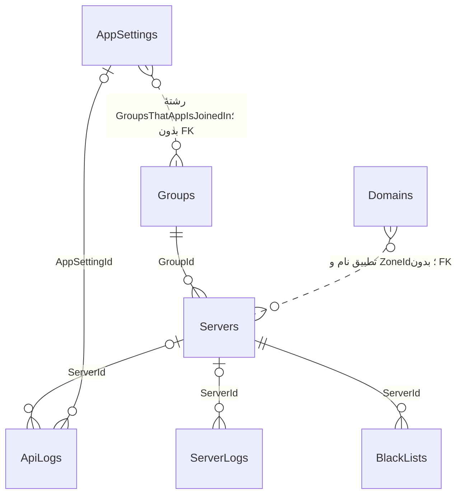

# تحلیل ذخیره‌سازی فعلی

منابع: `Project.Persistence/ApplicationDbContext.cs`، `Repositories/GenericRepository.cs`، entityها، ۴۲ migration دارای Up/Down و snapshot. ۸۵ فایل C# در پوشهٔ migrations وجود دارد؛ همهٔ آن‌ها migration مستقل نیستند. دیتابیس واقعی خوانده نشده؛ index، duplicate و orphan واقعی تولید نامعلوم است.

## مدل موجود

Identity جدول‌های AspNetUsers، Roles، Claims، Logins، Tokens و UserRoles دارد. جداول Jobs، Domains، IPConfigEntity، SaveIps، OperatorIdentifications و CronJobInfos روابط موردنیاز زمان‌بندی/اختصاص را مدل نمی‌کنند. رابطهٔ نقطه‌چین در شکل FK نیست.

| موضوع | شاهد کدی و اثر | پیشنهاد و اثر سازگاری |
|---|---|---|
| گروه‌های برنامه | AppSetting.GroupsThatAppIsJoinedIn رشتهٔ `1_2`؛ query روی GroupId.ToString | join افزایشی با حفظ رشتهٔ پاسخ legacy |
| حذف | GenericRepository.Delete نرم؛ Remove سخت؛ query عمومی فیلتر active ندارد | قرارداد نام‌دار و صریح برای active/all/archive؛ بدون پاک‌کردن گذشته |
| حذف log | DeleteServerLogs پارامتر count را مصرف نمی‌کند و همه را hard-delete می‌کند | retention مصوب، حذف دسته‌ای فقط دادهٔ واجد شرایط؛ اثر بر الگوریتم انتخاب ثبت شود |
| تاریخ و عامل | BaseEntity UTC؛ SaveChangesAsync مقدار UpdatedAt را DateTime.Now و UpdatedBy را SYSTEM می‌کند؛ SaveChanges sync آن override را دور می‌زند | UTC یکدست و actor واقعی؛ تبدیل زمان خارجی در adapter |
| nullable | AppSetting چند bool? و int? دارد اما DTO متناظر غیرnullable است | null واقعی و default کلاینت را با fixture تثبیت، سپس mapping صریح |
| JSON | Server.Config متن آزاد؛ ConfigKey/ConfigValue و JobConfig بدون schema/version | payload اصلی و metadata اعتبارسنجی جدا؛ شرح در سند JSON |
| ردیابی و concurrency | خواندن no-tracking؛ Update کل entity را Modified می‌کند؛ rowversion نیست | optimistic concurrency و patch محدود؛ جلوگیری از overwrite DNS/مدیر |
| transaction | هر repository write save مستقل؛ update سرور و مصرف domain دو commit و DNS خارج SQL | state machine و outbox؛ rollback بین دو سیستم تراکنش SQL عادی نیست |
| index | ApiRoute unique؛ FKهای Server.GroupId و ServerLog.ServerId موجود؛ بسیاری indexهای Id تکرار کلید اصلی‌اند | index مرکب بر query واقعی با plan آزمایشی؛ نبود index کلی ادعا نمی‌شود |
| uniqueness | SaveIps.Ip، DomainName، JobName و BlackList(ServerId,Ip) unique نیستند | بررسی و قرنطینهٔ تعارض پیش از constraint؛ حذف خودکار duplicate ممنوع |
| پول | User.Balance از نوع double و snapshot float | decimal(19,4) پیشنهادی با reconciliation، نه round خاموش |
| تنظیم Job | [StringLength] روی JobPeriodTime عددی؛ credential هم ستون و هم JobConfig | فیلد typed با check و secret reference؛ پاسخ مدیریتی بدون کلید |
| انتخاب IP | IpConfigService.Get(null) اولین رکورد بدون active/deleted/order؛ IP قبلی غیرفعال می‌شود | reservation قطعی و history؛ ورودی‌ها و خروجی Android ثابت |
| SaveIP | IpService.Insert اگر IP موجود باشد فقط حذف می‌کند و در همان درخواست جایگزین نمی‌سازد | رفتار toggle فعلی مستند و تست شود؛ اصلاح write در PR مصوب |

## هزینه و ناسازگاری بازیابی

`ServerService.GetWithFilter` countهای متعدد correlated و projection آمار می‌سازد؛ Include لزوماً به معنی N+1 نیست. `GetAllLogsStatistics` حدود ۱۲ Count synchronous جدا اجرا می‌کند. `GetAll()` پیش از filter در چند سرویس همهٔ ردیف‌ها را به حافظه می‌آورد. در JobController حلقهٔ هر سرور query آمار و سپس چند query دیگر ایجاد می‌کند؛ این تکرار متناسب با تعداد سرورهاست و باید با SQL plan/command count اندازه‌گیری شود.

projection فهرست بعضی فیلدهای ServerDTO مثل ConfigKey، ConfigValue، ZoneId و DomainDateTime را پر نمی‌کند، اما Detail نگاشت entity کامل دارد. UI از Group.Title و ساختار JSON بدون بررسی null استفاده می‌کند. JSON خراب یا group ناموجود کل render را متوقف می‌کند. `GetAllLogsStatistics` در کنترلر بدون await به Json داده می‌شود؛ سریال‌شدن Task به‌جای DTO باید تست شود و موفق فرض نشده است.

آخرین migration فقط ZoneId و ZoneIdLastSynced به Servers اضافه می‌کند. وجود ستون به معنی sync صحیح نیست: UpdateServerConfig عبارت خودانتسابی `server.ZoneId = server.ZoneId` دارد. migration تاریخی تغییر طول ستون دارد؛ اجرای همهٔ migrationها روی دادهٔ موجود بدون restore آزمایشی ایمن فرض نمی‌شود.
